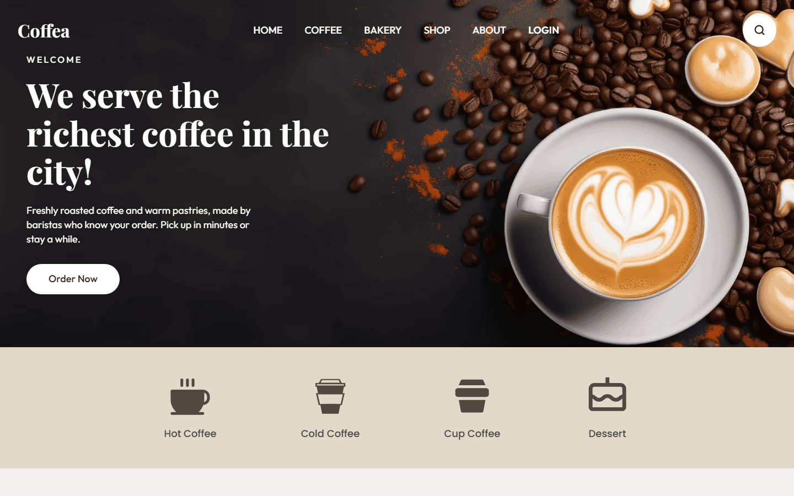

# Coffea

A concept landing page for a coffee shop. Portfolio project, not a real business.

**Live:** https://coffea-landing.vercel.app



## Results

PageSpeed Insights, production, mobile (2026-11-03): Performance 96, Accessibility 100, Best Practices 100, SEO 100.

## What's inside

- Responsive from 360 to 2560 px, built from a desktop-only Figma design
- WCAG 2.2 AA: keyboard navigation, visible focus, reduced motion, screen-reader labels
- Scroll-reveal and hover animations in plain CSS; the first screen is never animated
- Newsletter form with validation, a honeypot field and Resend delivery
- Security headers
- SEO: metadata, OG image, sitemap, robots, JSON-LD
- Vercel Web Analytics (cookieless)

## Stack

Next.js 16 (App Router), React 19, TypeScript, Tailwind CSS v4, shadcn/ui, React Hook Form + Zod, Resend, Vercel.

## Run locally

```bash
pnpm install
cp .env.example .env.local   # optional, only needed for the newsletter form
pnpm dev
```

The site runs at http://localhost:3000.

## Credits

Design: ["Coffea – Free Responsive Coffee Shop Website Template"](https://www.figma.com/community/file/1521850636801222788/coffea-free-responsive-coffee-shop-website-template) by Codexse, licensed under [CC BY 4.0](https://creativecommons.org/licenses/by/4.0/). Adapted: responsive layout, copy and interactions.

Development: Oleksandr Martian.
